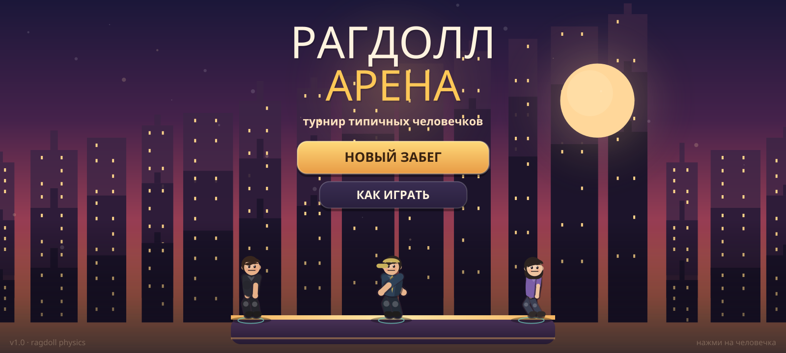
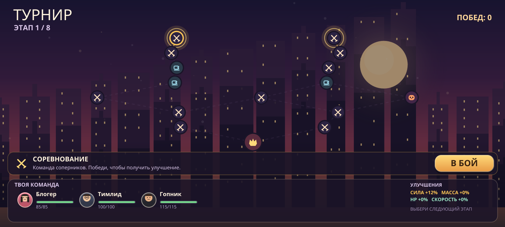
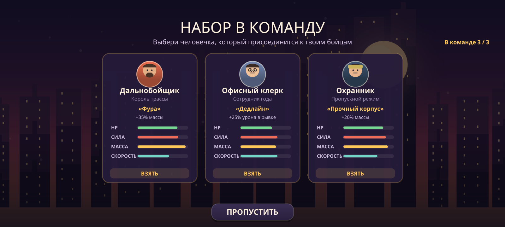
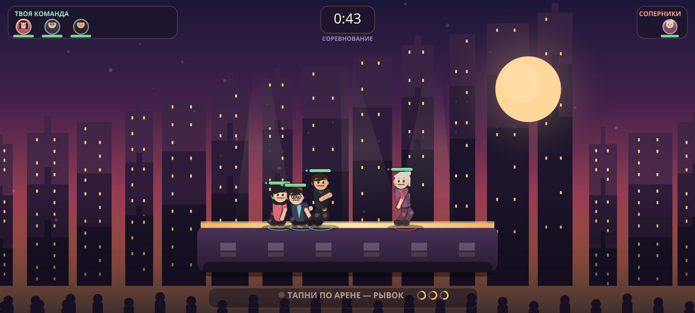
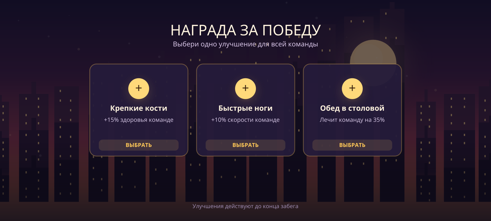
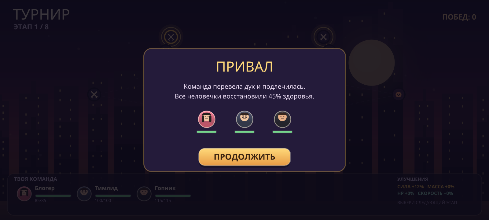
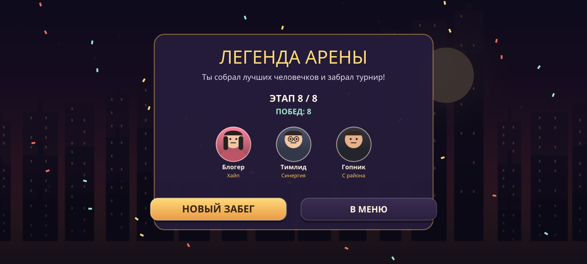
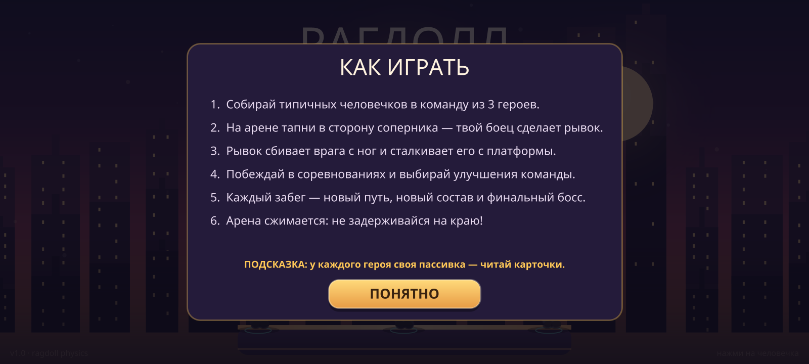

# РАГДОЛЛ АРЕНА

2D-рогалик для смартфонов, в котором ты собираешь команду **типичных человечков** и выставляешь их на физические соревнования. Человечки — настоящие тряпичные куклы (ragdoll): их мотает, закручивает, они спотыкаются, падают и сваливаются с арены.

**Готовый APK:** [`dist/RagdollArena-v1.0.apk`](dist/RagdollArena-v1.0.apk) (Android 5.0+, подписан debug-ключом).



## Что внутри

- **Рогалик-забег** из 8 этапов: ветвящаяся карта, случайные события, набор героев, улучшения и финальный босс.
- **14 персонажей** со своими статами, пассивками и внешностью: офисный клерк, бариста, студент, тимлид, дальнобойщик, бабушка, курьер, фитнес-тренер, гопник, учительница, программист, блогер, охранник и поэт.
- **Настоящая ragdoll-физика**: 11 точек тела, ограничения-кости, активная поза, стаггер от ударов, нокауты и полное обмякание.
- **Соревнования 1v1–3v3**: тап по арене отправляет всю готовую команду в рывок. Столкновения, урон, нокдауны, падения с платформы.
- **Сжимающаяся арена** и «последний шанс» — матчи гарантированно заканчиваются.
- **Красивая процедурная графика**: закатное небо, город с параллаксом, сцена с прожекторами, зрители, частицы, вспышки, экранная тряска, вибрация.
- Полностью **офлайн**, без рекламы и без сторонних библиотек.

## Скриншоты

| Карта турнира | Набор в команду |
|---|---|
|  |  |

| Бой | Награда за победу |
|---|---|
|  |  |

| Привал | Финал |
|---|---|
|  |  |

## Как играть

1. Нажми **«НОВЫЙ ЗАБЕГ»** — получишь двух случайных человечков.
2. На карте выбирай следующий этап: соревнование, элитный бой, набор в команду или привал.
3. В бою **тапни по арене** — все бойцы с заряженным рывком прыгнут в сторону тапа. Рывок сбивает соперника с ног.
4. Побеждай, забирай улучшения, собирай команду до 3 героев и дойди до финального босса.
5. Каждый забег — новые герои, карта и награды. Смерть в бою означает конец забега.



## Сборка APK

### Вариант 1 — готовый APK

Файл `dist/RagdollArena-v1.0.apk` уже собран и подписан. Перекинь его на телефон, разреши установку из неизвестных источников и установи.

### Вариант 2 — скрипт без Gradle

Нужны JDK 17 и Android SDK (platform `android-33`, build-tools `34.0.0`).

```bash
JAVA_HOME=/path/to/jdk ANDROID_SDK_ROOT=/path/to/sdk bash scripts/build_apk.sh
```

Скрипт компилирует ресурсы через `aapt2`, код через `javac`, собирает dex через `d8`, выравнивает через `zipalign` и подписывает через `apksigner`. Результат: `dist/RagdollArena-v1.0.apk`.

### Вариант 3 — Android Studio / Gradle

Открой корень проекта в Android Studio и нажми Run. Или:

```bash
gradle assembleDebug
```

APK появится в `app/build/outputs/apk/debug/app-debug.apk`. Проект собран и проверен на Gradle 7.6.3 + AGP 7.4.2.

## Управление

- **Тап по арене в бою** — командный рывок (у каждого бойца свой откат).
- **Тап по карте** — выбрать этап, повторный тап или кнопка «В БОЙ» — начать.
- **Тап по человечку в меню** — толкнуть его, чтобы посмотреть на физику.

## Статы и пассивки

| Герой | Пассивка | Эффект |
|---|---|---|
| Офисный клерк | Дедлайн | +25% урона в рывке |
| Бариста | Двойной эспрессо | рывок заряжается на 30% быстрее |
| Студент | Халява | +25% здоровья |
| Тимлид | Синергия | +12% силы всей команде |
| Дальнобойщик | Фура | +35% массы |
| Бабушка | Божий одуванчик | −25% получаемого урона |
| Курьер | Срочно | +20% скорости |
| Фитнес-тренер | Жим лёжа | +25% силы |
| Гопник | С района | +20% массы, +10% силы |
| Учительница | Дисциплина | +15% силы и здоровья |
| Программист | Легаси-код | +30% здоровья, −10% скорости |
| Блогер | Хайп | +30% урона в рывке, −10% массы |
| Охранник | Прочный корпус | +20% массы |
| Поэт | Слово лечит | команда лечится после боя |

Улучшения после побед усиливают всю команду: здоровье, сила, масса, скорость, лечение и «командный дух».

## Структура проекта

```
app/src/main/java/com/ragdollarena/game/
  MainActivity.java   — активность, fullscreen, вибрация
  GameView.java       — сцены, ввод, HUD, карта, экраны
  Art.java            — вся процедурная графика и персонажи
  BattleSim.java      — симуляция боя, ИИ, урон, эффекты
  Ragdoll.java        — verlet-рагдолл и ограничения
  Fighter.java        — статы, активная поза, рывки, нокауты
  Chars.java          — 14 шаблонов персонажей
  RunState.java       — карта, команда, улучшения, генерация врагов
tools/
  TestSim.java        — headless-тест симуляции (без Android)
scripts/
  build_apk.sh        — сборка подписанного APK без Gradle
```

## Тесты

Симуляция боя и карты проверяется без Android:

```bash
mkdir -p build/test
javac -encoding UTF-8 -d build/test \
  app/src/main/java/com/ragdollarena/game/Chars.java \
  app/src/main/java/com/ragdollarena/game/Ragdoll.java \
  app/src/main/java/com/ragdollarena/game/Fighter.java \
  app/src/main/java/com/ragdollarena/game/BattleSim.java \
  app/src/main/java/com/ragdollarena/game/RunState.java \
  tools/TestSim.java
java -cp build/test TestSim
```

Тест прогоняет 96 боёв на всех этапах, проверяет отсутствие NaN, завершаемость матчей и связность 300 сгенерированных карт.

---

Сделано с любовью к физике, закатам и типичным человечкам.
